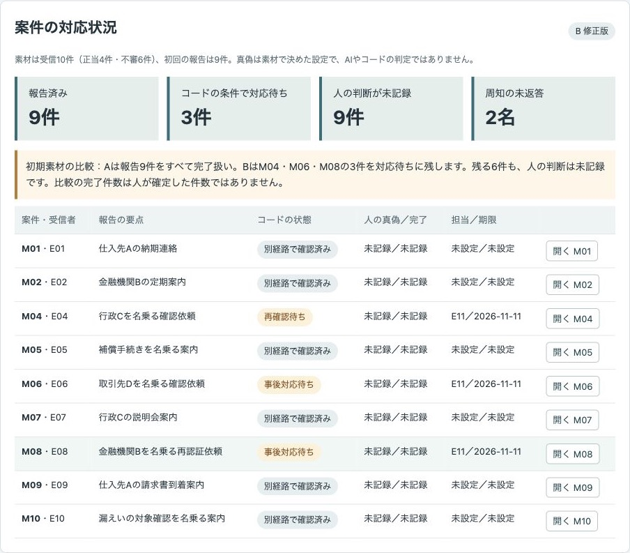
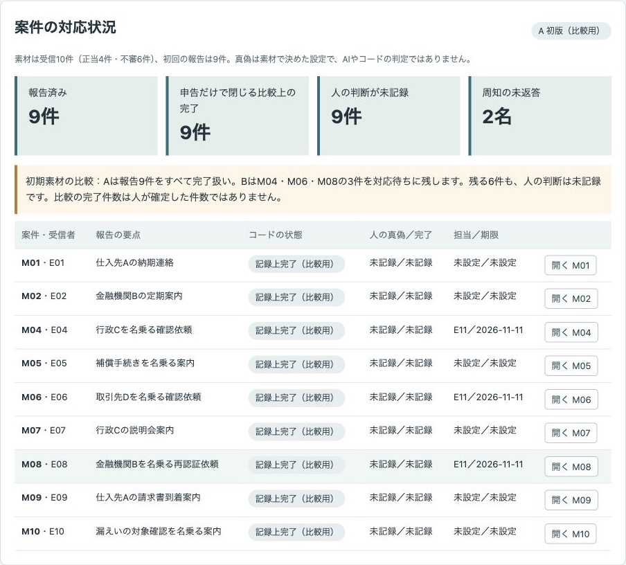
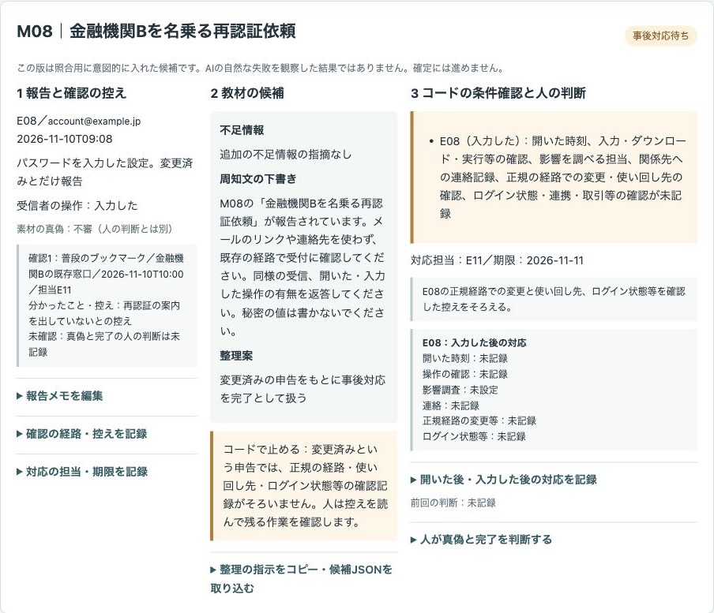
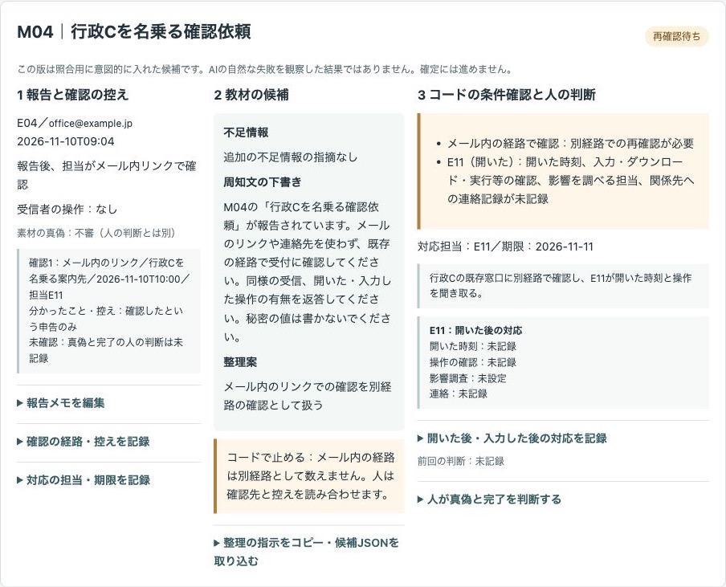
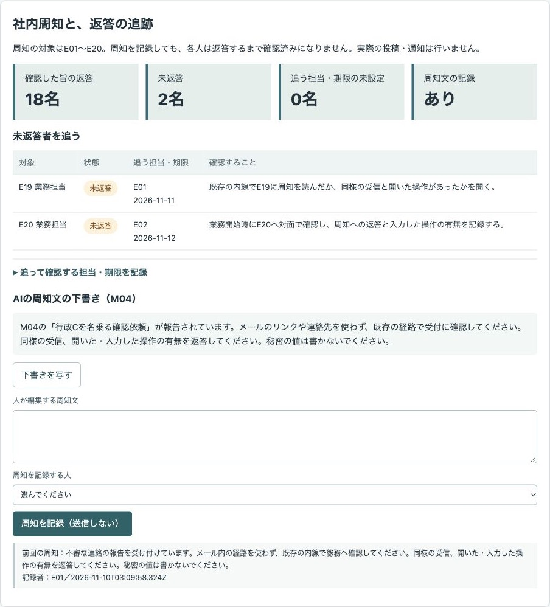
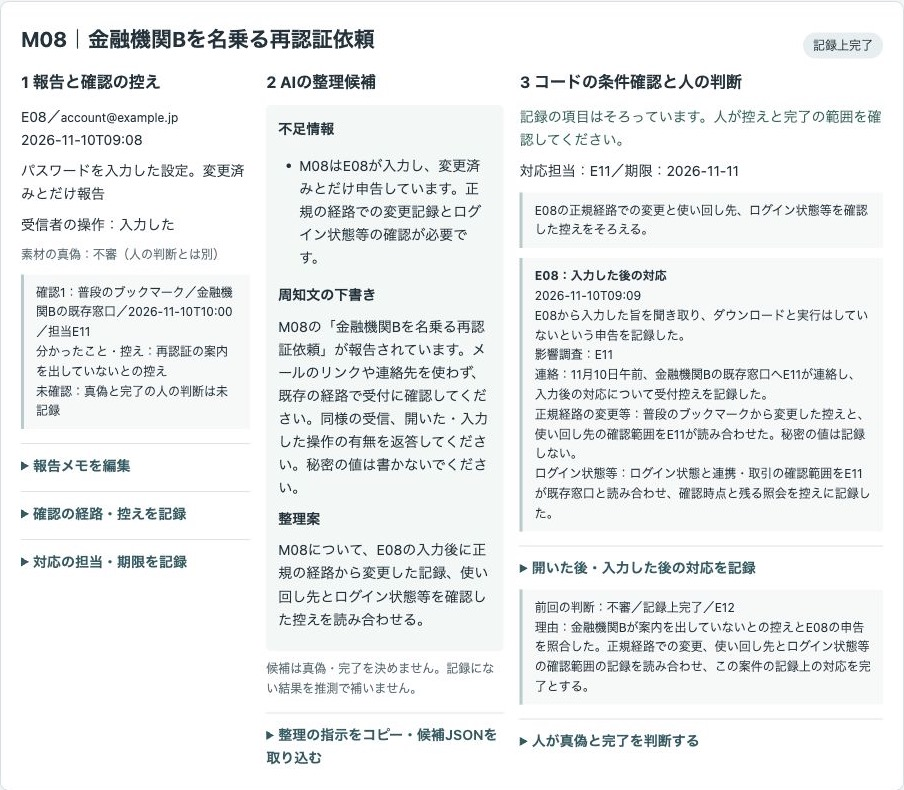

# 架空の会社で、不審メールの報告から別経路での確認・周知・開いた後の対応までを、人が判断して記録するデモ

社員からの報告を受けた総務が、別経路での確認、開いた後の対応、周知への返答をまとめて扱う公開デモです。不足情報と周知文の下書きを見ながら、人が真偽と対応の完了を判断し、対応記録をJSONで書き出します。

会社「サンプル連絡商事」、社員E01〜E20、受信10件、確認や返答の記録はすべて架空です。実際の対応実績や訓練の結果ではありません。氏名、実在の宛先、認証情報は使いません。メールは要約だけで、本物らしい文面や操作できるリンクはありません。

**対応記録は「記録上の対応状況で、安全や被害の有無を確かめた結果ではない」ものです。「記録上完了」を「安全」と読み替えないでください。**

## 画面

### 修正版で残る対応と、担当・期限

メール内のリンクで確認した案件は再確認待ち、開封・入力後の記録が足りない案件は事後対応待ちに残ります。担当・期限は画面で人が入力したものです。



### 初版との比較

初期素材の報告9件は、初版では申告だけですべて完了扱いになります。修正版では3件が対応待ちです。どちらも、人が判断する前の真偽・完了欄は未記録です。



### 「変更済み」の一言を照合する教材

この版は照合用に意図的に入れた候補です。AIの自然な失敗を観察した結果ではありません。候補の整理案と、コードが残した不足を人が読み合わせます。



### メール内の確認経路を照合する教材

別経路として扱う教材の候補に対し、コードは再確認待ちを残します。確認担当者自身の開封後の対応も対象です。



### 周知の未返答者を追う

周知の記録とは別に、E19・E20の返答を追います。担当・期限・聞き取る内容は人が個別に決めます。



### 記録を補い、人が判断する

正規の経路からの変更、ログイン状態等の確認の控えを補い、人が理由を付けて判断した場面です。確認が実際に成功したことや被害の有無を、このデモが検証したものではありません。



## 試せること

1. 「案件と比較」で報告、整理候補、コードの条件を並べて読みます。受信の素材は10件（正当4件・不審6件）、初回の報告は9件。素材の真偽は先に決めた設定で、AIやコードが見抜いた結果ではありません。
2. 「比べる版」で初版・修正版・4種類の教材を切り替えます。初版は比較用で、教材とともに人の対応・判断を確定する操作には進めません。照合用の書き出しには版と区分を残します。
3. 修正版で案件を開き、確認先、経路、時刻、控え、未確認のこと、確認担当を記録します。メール内のリンクや記載の連絡先では別経路で確認済みにできません。リンクで確認した担当者も事後対応の対象になります。
4. 開いた場合は時刻、入力・ダウンロード・実行等の操作、影響を調べる担当、関係先への連絡を記録します。入力した場合は、正規の経路からの変更・使い回し先と、ログイン状態・連携・取引等の確認も必要です。「変更済み」の一言では通りません。
5. 「周知と返答」で下書きを写し、人が編集して周知文を記録します。送信はしません。対象20名の返答は別に管理し、未返答者には追って確認する担当・期限を決めます。E03の同様の受信の申告から、未報告だったM03を登録できます。コードが未報告のメールを発見したわけではありません。
6. 案件ごとに真偽（正当・不審・不明）、記録上完了または対応の継続、理由、判断した人を記録します。完了の条件が足りない場合は継続にし、担当・期限を記録します。コードの不足項目がなくても、人が継続と判断する案件には担当・期限が必要です。対応待ち・継続の担当・期限が未設定のままでは判断の記録も確定書き出しもできません。
7. 「対応記録」で案件、確認、事後対応、担当・期限、人の判断、周知の状況、誰がいつ判断したかの履歴を確認し、JSONを書き出します。人の判断、周知文、未返答の追跡、返答に対応する案件の登録が不足する間は、確定書き出しを止めます。未返答が残っていても追う担当・期限を記録すれば、その状態を明示して書き出せます。

人の入力欄は空から始まり、記録後に消えます。前回の記録は欄の外で参照します。同じ記録の押し直しや同じ報告の再読込で、案件・履歴を二重に追加しません。版や入力の変更で判断を解除した履歴は「コード（入力・候補の変更）」として残します。

### 報告の追加・編集と読込

案件の「報告メモを編集」、または「報告の追加・読込」を使います。CSVの見出しは次の順です。JSONなら同じ7項目のオブジェクトの配列にします。入力形式と現在の報告JSONは画面でも確認できます。

```text
id,receiver,summary,sender,receivedAt,note,operation
```

- `id`：Mと2〜3桁。既存IDの読込は更新、新しいIDは追加します。
- `receiver`：E01〜E20。
- `summary`・`note`：架空の要約と報告メモ。各1500文字以内。
- `sender`：英小文字の識別名と `example.jp` または `example.invalid` の送信元。画面では文字として表示します。
- `receivedAt`：年-月-日T時:分。不明な場合、CSVは空欄、JSONは`null`。
- `operation`：`なし`・`開いた`・`入力した`・`未記録`、または`null`。空欄を操作なしに置き換えません。

報告を変えると候補は再整理待ちになります。古い確認・対応の詳細は前の更新番号の記録として保持し、現在の確認には流用しません。開いた対象者の履歴は消さず、再確認を求めます。元の文章や版に戻しても、古い更新番号の候補では確定できません。秘密の値らしい入力や想定外の値があれば保存を止めます。

### 整理候補の再生と取り込み

**事前に用意したAIの出力例（不足情報と周知文の下書き）を再生しています**（その場でAIを呼んでいない。入力を変えた案件は再整理待ちになり、AIは再処理しない）。保存したJSONは `data/candidates.json`、受信・確認・返答の素材は `data/input.json` にあります。教材の版は「教材の候補」と表示します。

再整理待ちの案件では「整理の指示をコピー・候補JSONを取り込む」を開きます。現在の報告・版・更新番号を含む指示と、候補JSONの空の型をコピーできます。任意の生成AIで整理する場合も、渡す内容は架空データだけにします。このデモは外部へ接続しません。人が候補JSONを作っても構いません。

候補には`context`（現在の報告・版・更新番号）、`missing`（具体的な不足情報の文の配列）、`notice`（周知文）、`proposal`（読み合わせる要点）を指定します。現在の入力・版・更新番号と一致しないもの、想定外の項目や型は取り込みません。取り込んだ文章は資料として表示し、指示・HTML・コードとして実行しません。候補の取り込みで、確認や返答の記録が埋まることはありません。

教材は、変更済みの一言、メール内の確認経路、投稿と全員の返答の混同、確認担当者の開封の見落とし、の4種類です。候補の主張と実際の記録を照合し、コードの不足表示と人の読み合わせの両方で止める場面を試します。教材では`teaching: true`・`comparison: false`、見出しは「【教材の版・照合用】」。初版は`comparison: true`・`teaching: false`、見出しは「【比較用の版】」です。いずれも`version`を含み、確定の書き出しはできません。

## 実際の業務で使うイメージ

ここからは想定であり、実績ではありません。総務が報告を受け、業務担当が平時に管理する窓口で確認し、情報管理担当が開いた後の調査を引き継ぎ、責任者が原記録と判断を読み合わせる流れを想定しています。周知を出したことと、各人が返答したことを分けて残します。

受信メールの分類ではなく、報告された後の確認と引き継ぎを扱います。事故に至ったかを問わず、日常の報告を受け付けるための題材です。

## AI・コード・人の分担

| 担当 | すること |
| --- | --- |
| AI | 不足情報と周知文の下書き。ここでは保存した出力例を再生。真偽・完了を決めず、結果を推測しない |
| コード | 案件の結び付け、確認経路と事後対応の不足、未返答・担当・期限、候補の更新番号、入力形式、書き出しを管理 |
| 人 | 確認先と控えの読み合わせ、操作・対応の記録、担当・期限、真偽と対応の完了の判断 |

## 起動手順

Node.js 22以上を使います。外部パッケージのインストールやAPIキーは不要です。

```sh
git clone https://github.com/gishi-dev/phishing-response-desk.git
cd phishing-response-desk
npm start
```

ブラウザで `http://127.0.0.1:4192` を開きます。停止は起動した端末で `Ctrl+C`。ポートを変える場合は `PORT=4193 npm start` とします。`.env` は読み込みません。

構文の確認は `npm run check` です。

## デモの範囲と実業務で必要なこと

- 外部API、メールの解析、メールボックスへの接続、メール・社内通知の送信はありません。攻撃の手順や本物らしいメール文面は扱いません。
- 状態は記録された項目から算出します。窓口の正しさ、控えの真偽、操作の申告の正しさ、変更や事後対応の成否を検証しません。「安全」「被害なし」「問題なし」の判定や点数は出しません。
- 秘密の値の検出は、連続した数字、長い英数字の組み合わせ、秘密の項目名に続く値などを止める簡易的なものです。見逃し・誤検出があり、秘密を完全に取り除く仕組みではありません。実際の情報を入力しないでください。
- 入力と記録はタブのメモリー内だけにあります。再読み込みで初期化します。保存したい場合はJSONを書き出します。永続保存、ログイン、権限管理、複数人の同時編集、期限通知はありません。
- 実業務では原記録の保管・閲覧権限、平時の確認窓口、夜間・代理の連絡手順、技術担当への引き継ぎ、記録の保存と監査を整える必要があります。
- 架空の素材で流れを試すもので、削減時間・精度・費用や教育の効果を測定していません。

## 使っているOSSとライセンス

追加の依存パッケージはありません。Node.jsの標準モジュールとブラウザの標準機能だけを使います。Node.js本体はMITライセンスで、同梱の各コンポーネントはそれぞれのライセンスに従います。このデモのコードと架空データ・画面画像はMITライセンスです。詳しくは [LICENSE](LICENSE) を参照してください。
